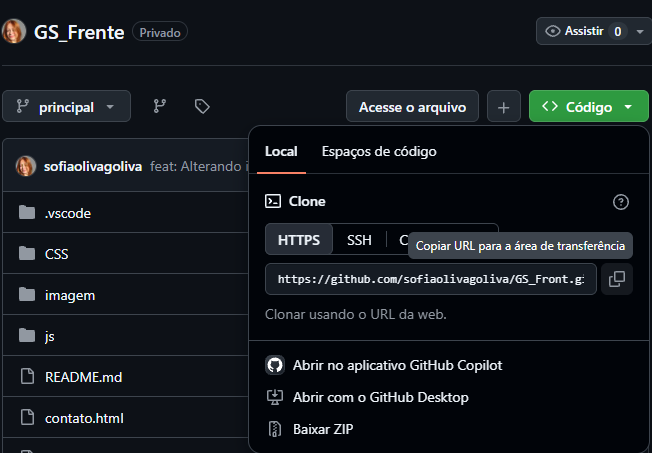
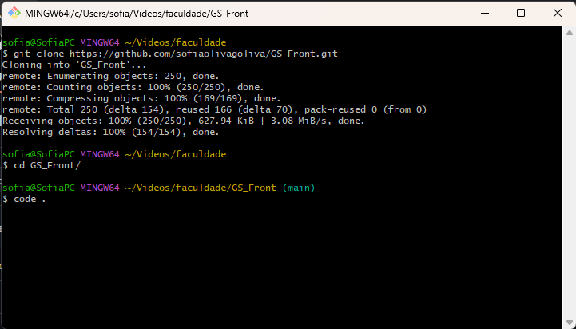
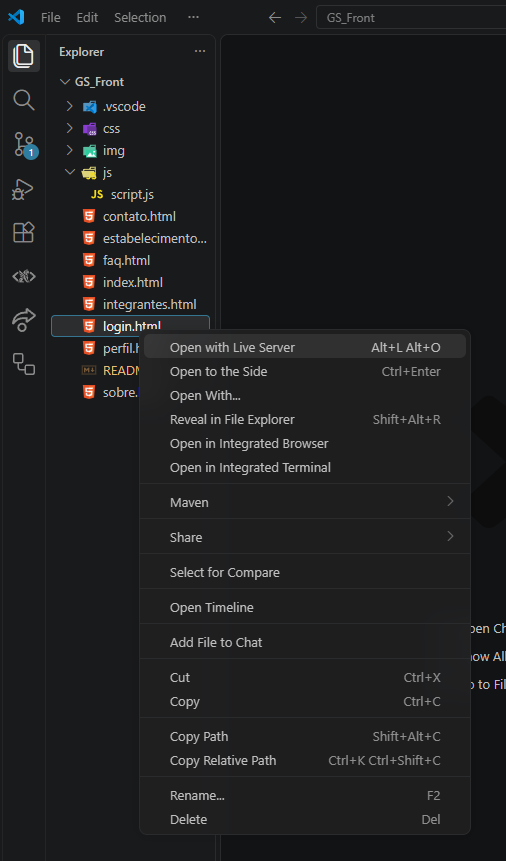
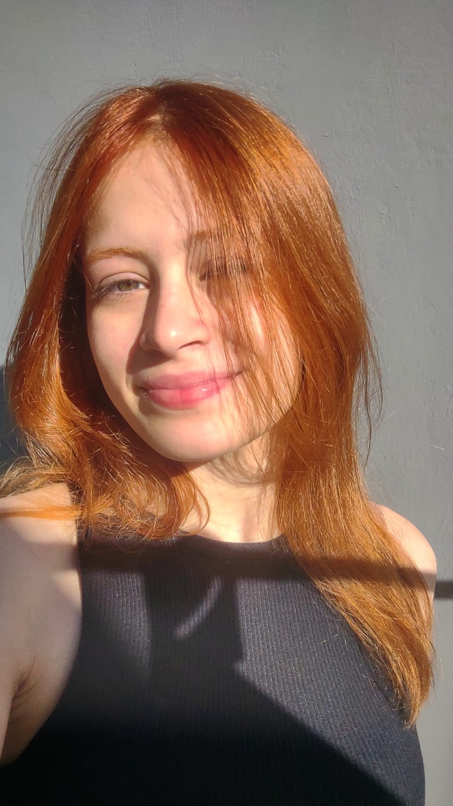

# 💡 ReTaste — Front-End Design Engineering

Este projeto consiste no desenvolvimento de um website para uma Iniciação Científica, como parte de uma atividade acadêmica da disciplina Front-End Design Engineering, da FIAP, em 2026.

## ↗️ Acessando o website através do repositório
<div align="center">

<table>
  <tr>
    <td align="center" width="180">
      
      <br><br>
      <strong>Clone o repositório</strong>
      <br>
      <sub>Copie e cole a URL em um terminal para obter o repositório no explorer</sub>
    </td>

<td align="center" width="180">
  
  <br><br>
  <strong>Abrir no VS Code</strong>
  <br>
  <sub>Pelo terminal digite "cd GS_Front" para entrar no repositório.</sub>
  <br>
  <sub>em seguida digite "code ." no terminal, para acessar o VS Code.</sub>
  <br><br>
</td>

<td align="center" width="180">
  
  <br><br>
  <strong>Visualizar no browser</strong>
  <br>
  <sub>Após selecionar "trust" em Workspace Trust, com o botão direito do mouse, selecione o arquivo "login.html" e escolha Open with live server.</sub>
</td>
  </tr>
</table>

</div>


## 💙 Sobre a ReTaste

O **ReTaste** é uma proposta de plataforma digital desenvolvida para conscientizar sobre a relação entre o desperdício de alimentos e a insegurança alimentar no Brasil e no mundo.

Por meio de dados e informações relevantes, o projeto busca evidenciar o contraste entre a quantidade de alimentos descartados e o número de pessoas que enfrentam dificuldades para ter acesso à alimentação.

Além da conscientização, a proposta visa conectar pessoas físicas e estabelecimentos comerciais interessados em contribuir com a redução do desperdício, permitindo o cadastro de alimentos disponíveis para doação ou oferta.

O website apresenta o conceito da plataforma, seus objetivos, funcionalidades, informações sobre a iniciativa e sua equipe, além de um protótipo visual que demonstra como a solução poderá funcionar na prática.

## 📌 Objetivos

- Desenvolver uma interface web organizada, intuitiva e responsiva.
- Aplicar os fundamentos de HTML5, CSS3 e JavaScript.
- Conscientizar sobre os impactos sociais e ambientais do desperdício de alimentos.
- Incentivar a doação e o aproveitamento de alimentos próprios para consumo.
- Demonstrar, por meio de uma solução digital, como a tecnologia pode contribuir para enfrentar problemas sociais.
- Praticar versionamento de código com Git e GitHub.

## 🛠️ Tecnologias utilizadas

- **HTML5:** estruturação e organização das páginas.
- **CSS3:** estilização, layout e identidade visual (o style.css com os estilos gerais e uma folha de estilos para cada página).
- **JavaScript:** implementação de interações, validações e funcionalidades dinâmicas.
- **Git:** controle de versão do projeto.
- **GitHub:** armazenamento e gerenciamento do repositório.
- **Visual Studio Code:** ambiente de desenvolvimento.

## 🗃️ Estrutura do projeto

```text
📁 GS_Front/
├── 📁 .vscode/
│   └── settings.json
├── 📁 css/
│   ├── style.css            # estilos gerais (compartilhados)
│   ├── contato.css
│   ├── estabelecimento.css
│   ├── faq.css
│   ├── index.css
│   ├── integrantes.css
│   ├── login.css
│   ├── perfil.css
│   └── sobre.css
├── 📁 img/
│   ├── cebolinha.svg
│   ├── cenoura.svg
│   ├── clone.png
│   ├── coxa.svg
│   ├── enrique.jpeg
│   ├── espetinho.svg
│   ├── estabelecimento.svg
│   ├── home.svg
│   ├── laranja.svg
│   ├── live.png
│   ├── logo.svg
│   ├── marina.jpeg
│   ├── melancia.svg
│   ├── nigiri.svg
│   ├── ovo-real.svg
│   ├── ovo.svg
│   ├── path.png
│   ├── perfil.svg
│   ├── picole.svg
│   ├── pizza.svg
│   ├── plant-escura.svg
│   ├── plant-medium.svg
│   ├── planta-clarissima.svg
│   ├── planta-media.svg
│   ├── pollo.jpeg
│   ├── prato.svg
│   ├── quadrado-claro.svg
│   ├── quadrado-escuro.svg
│   ├── quadrado-medio.svg
│   ├── queijo.svg
│   ├── rafael.jpeg
│   ├── retangulo-claro.svg
│   ├── retangulo-escuro.svg
│   ├── retangulo-medio.svg
│   └── sofia.jpeg
├── 📁 js/
│   └── script.js            # interações de todas as páginas
├── 📁 projeto/
│   ├── contato.html
│   ├── estabelecimentos.html
│   ├── faq.html
│   ├── index.html
│   ├── integrantes.html
│   ├── login.html
│   ├── perfil.html
│   └── sobre.html
├── identificacao.txt
└── README.md
```


## 🔍 Funcionalidades e páginas

- **Cadastro e login:** interfaces demonstrativas para cadastro de usuários e estabelecimentos parceiros.
- **Página inicial:** apresentação da iniciativa e orientação sobre a navegação.
- **Sobre:** exposição de dados sobre fome, insegurança alimentar e desperdício de alimentos no Brasil e no mundo.
- **Doações e ofertas:** proposta de cadastro e divulgação de alimentos disponíveis para doação ou oferta.
- **Estabelecimentos:** espaço destinado à apresentação de estabelecimentos e ofertas de participantes da iniciativa.
- **FAQ:** perguntas frequentes para orientar os usuários.
- **Integrantes:** apresentação dos integrantes responsáveis pelo projeto.
- **Perfil:** área de verificação de dados e produtos cadastrados, com a simulação da possibilidade de adicionar ou retirar produtos do catálogo.

## 📕 Aprendizados

O desenvolvimento do ReTaste proporcionou a aplicação prática dos conhecimentos adquiridos na disciplina de Front-End Design Engineering, sendo eles:
- Estruturação semântica de páginas com HTML5.
- Organização de estilos utilizando CSS3.
- Manipulação de elementos com JavaScript.
- Hierarquia visual e experiência do usuário (UX/UI).
- Aplicação de conceitos de responsividade e acessibilidade.
- Utilização do Git e GitHub para versionamento e gerenciamento do projeto.
- Solução de um problema real e global.

Além dos conhecimentos técnicos, o projeto permitiu explorar a relação entre tecnologia, responsabilidade social e sustentabilidade, demonstrando como o desenvolvimento web pode ser utilizado para propor soluções a desafios presentes na sociedade.

## 🤝 Contexto acadêmico

**Instituição:** FIAP  
**Curso:** Análise e Desenvolvimento de Sistemas  
**Disciplina:** Front-End Design Engineering  
**Projeto:** Iniciação Científica, ReTaste  
**Ano:** 2026


## 👥 Nossa Equipe
<div align="center">

<table>
  <tr>
    <td align="center" width="180">
      
      <br><br>
      <strong>Rafael Madeira</strong>
      <br>
      <sub>Banco de Dados</sub>
      <br>
      <sub>RM 575635 · 1TDSPA</sub>
      <br><br>
      <a href="https://www.linkedin.com/in/rafael-madeira-b8545b312/">LinkedIn</a>
      ·
      <a href="https://github.com/Ribeir0296">GitHub</a>
    </td>

<td align="center" width="180">
  
  <br><br>
  <strong>Enrique Trindade</strong>
  <br>
  <sub>ChatBot</sub>
  <br>
  <sub>RM 576314 · 1TDSPA</sub>
  <br><br>
  <a href="https://www.linkedin.com/in/enrique-trindade-46a0012b4/">LinkedIn</a>
  ·
  <a href="https://github.com/enriquetrindade">GitHub</a>
</td>

<td align="center" width="180">
  
  <br><br>
  <strong>Julio Bernardes</strong>
  <br>
  <sub>Desenvolvimento Python</sub>
  <br>
  <sub>RM 575649 · 1TDSPA</sub>
  <br><br>
  <a href="https://www.linkedin.com/in/julio-bernardes-da-silva-40738b431/">LinkedIn</a>
  ·
  <a href="https://github.com/JulioSilva101">GitHub</a>
</td>

<td align="center" width="180">
  
  <br><br>
  <strong>Marina Queiroz</strong>
  <br>
  <sub>Entregas e regras de negócio</sub>
  <br>
  <sub>RM 574491 · 1TDSPA</sub>
  <br><br>
  <a href="https://www.linkedin.com/in/marina-santana-queiroz-9baa77241/">LinkedIn</a>
  ·
  <a href="https://github.com/marinasantanaq">GitHub</a>
</td>

<td align="center" width="180">
  
  <br><br>
  <strong>Sofia Oliveira Gonçalves</strong>
  <br>
  <sub>Front-end e design</sub>
  <br>
  <sub>RM 576524 · 1TDSPA</sub>
  <br><br>
  <a href="https://www.linkedin.com/in/sofia-goncalves-272472431/">LinkedIn</a>
  ·
  <a href="https://github.com/sofiaolivagoliva">GitHub</a>
</td>

  </tr>
</table>

</div>

---

*Transformando o excesso em oportunidade e levando esperança a quem mais precisa.* 🌱

--- 

## 🌱 Contato
- **Email:** contatoretaste@outlook.com

--- 

**Link do repositório:** https://github.com/sofiaolivagoliva/GS_Front

---

## 🌐 Site publicado

Acesse o projeto online: **[gsretaste.netlify.app/projeto](https://gsretaste.netlify.app/projeto/)**

